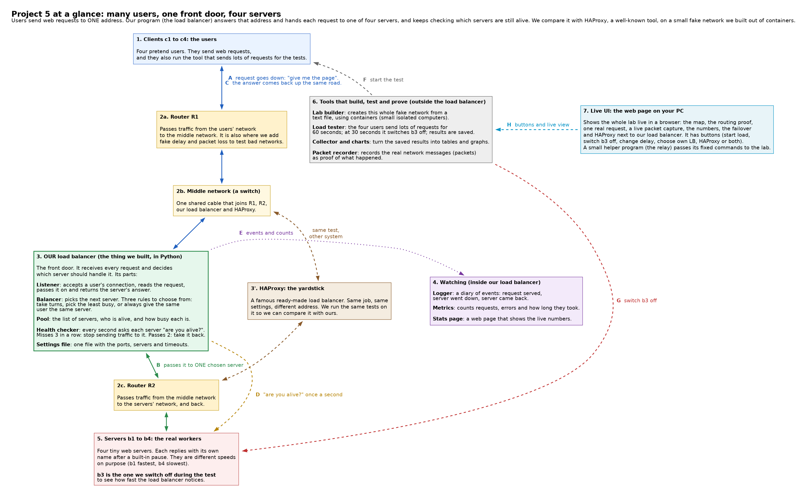

# Project at a glance

Read this first if you know nothing about the project. No numbers here, only what each part is and why it exists.

(Source: `project_at_a_glance.dot`. A scalable version is `project_at_a_glance.svg`. For the exact addresses and ports see `architecture.png`.)

## The whole project in four sentences
1. Many users ask for a web page, but we do not want them all to hit one server.
2. So we put a **front door** in the middle: a program called a **load balancer**. It takes each request and hands it to one of four servers.
3. It also keeps asking the servers "are you alive?", and stops using one that has died.
4. To prove it works, we built a small fake network, ran tests (including switching one server off on purpose), and compared our program with **HAProxy**, a well-known one.

## How one request travels (follow the letters in the picture)
| Step | What happens | Letter |
|---|---|---|
| 1 | A user (client) sends a request: "give me the page". | A |
| 2 | It passes through router R1 and the middle network and reaches the load balancer. | A |
| 3 | The load balancer picks ONE server using its rule (take turns, least busy, or same user = same server). | B |
| 4 | The request goes through router R2 to that server. | B |
| 5 | The server answers with its own name. The answer returns along the same road. | C |
| 6 | Meanwhile, once a second, the load balancer asks every server "are you alive?". | D |
| 7 | Meanwhile, it also writes a diary of what happened and keeps counts for a live page. | E |
| 8 | During tests, a tool starts the users (F) and switches server b3 off (G) to see how fast the load balancer notices. | F, G |

## What each thing is (one line each)
| Thing | One simple line | Where it is in the project | Look up |
|---|---|---|---|
| Clients c1-c4 | Four pretend users that send requests and run the load-test tool. | made by `topo/`, tool in `bench/client/` | HTTP client, curl |
| Router R1, R2 | Boxes that pass traffic between different networks. | `topo/` | router, static route |
| Subnet | A group of addresses that can talk directly (we have three: users, middle, servers). | `topo/clab.yml` | subnet, IP address |
| Switch / bridge | A shared cable that joins several devices in one network. | `topo/clab.yml` | network switch, Linux bridge |
| Our load balancer | The front door we wrote in Python; it receives requests and forwards them. | `lb/` | reverse proxy, load balancer |
| Listener | The part that accepts a connection, reads the request and passes it on. | `lb/core/` | TCP, HTTP/1.1, asyncio |
| Balancer | The part that chooses the next server. | `lb/balancing/` | round robin, least connections, IP hash |
| Pool | The list of servers, who is alive and how busy each one is. | `lb/balancing/pool.py` | server pool |
| Health checker | Asks each server "are you alive?" every second and removes a dead one. | `lb/balancing/health.py` | health check |
| Settings file | One file holding ports, servers and timeouts. | `config.example.json`, `lb/config.py` | JSON |
| Logger | A diary of events: request served, server down, server back. | `lb/obs/logger.py` | structured logging, JSON lines |
| Metrics | Counts requests, errors and how long they took. | `lb/obs/metrics.py` | latency, percentile |
| Stats page | A web page and data feed that show the live numbers. | `lb/obs/stats_server.py`, `lb/obs/dashboard/` | metrics endpoint |
| HAProxy | A famous ready-made load balancer, our yardstick. | `haproxy/` | HAProxy |
| Servers b1-b4 | Four tiny web servers with different speeds; b3 is the one we switch off. | `backends/` | web server, health endpoint |
| Lab builder | Creates the whole fake network from a text file using containers. | `topo/` | containers, Docker, containerlab, FRR |
| Network delay and loss | A setting on R1 that makes the network slower or lossy on purpose. | `topo/set_rtt.sh`, `set_loss.sh` | tc netem |
| Load tester | Sends many requests for a fixed time and saves the results. | `bench/` | load testing, hey, wrk |
| Collector and charts | Turn saved results into tables and graphs. | `bench/collect.py`, `analyze.py` | benchmark analysis |
| Packet recorder | Records the real network messages as proof. | `topo/capture.sh`, `captures/` | packet capture, tcpdump, Wireshark |

## Words you will see everywhere
| Word | Plain meaning |
|---|---|
| Container | A small isolated computer that starts in seconds. Every box in the lab is one. |
| Request / response | A user asks for a page; a server answers. |
| Port | A numbered door on an address (for example 8080 is the load balancer's front door). |
| Keep-alive | Reusing one connection for several requests instead of reconnecting each time. |
| Failover | When one server dies and traffic moves to the others automatically. |
| Layer 4 vs layer 7 | Layer 4 forwards raw connections without reading them; layer 7 (ours) reads the web request first. The report must explain this difference. |
| Packet | One small message on the network. A packet recorder saves them. |

## Things worth knowing early
- **Each fake machine has a hidden helper container** (a "network holder") that owns its address. That is why killing a server leaves its address alive and connections are refused instead of timing out.
- **The servers are unequal on purpose**, so that the three balancing rules behave differently.
- **We never run tests on `localhost`.** They run on the routed lab, so the packets really cross two routers.
- **Our program is written with only the Python standard library.** Third-party tools are used only for servers and testing.

## Where to read more
- Exact addresses and ports: `architecture.png`.
- Rules, decisions and numbers: `PRD.md`.
- What was measured and captured so far: `evidence/`.
